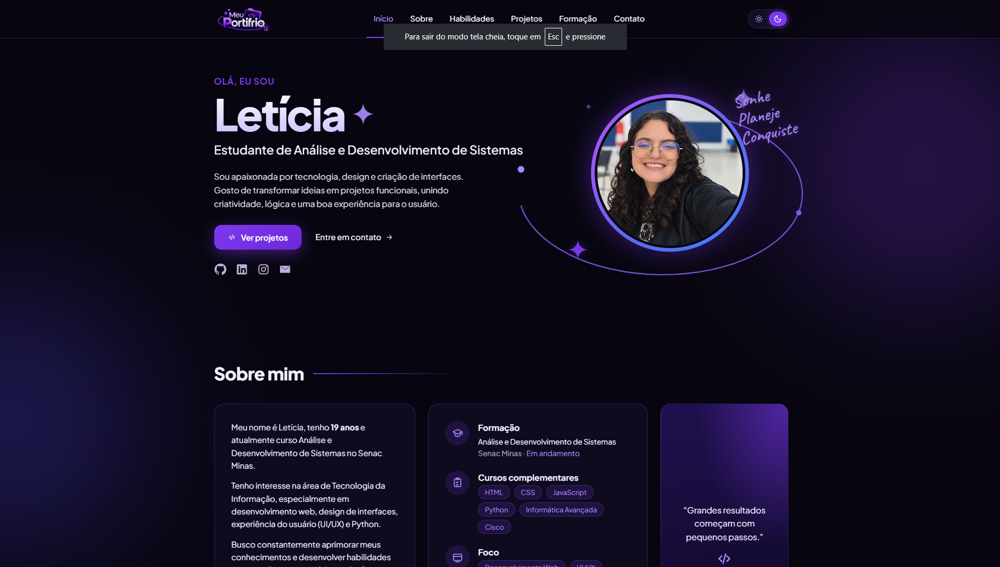
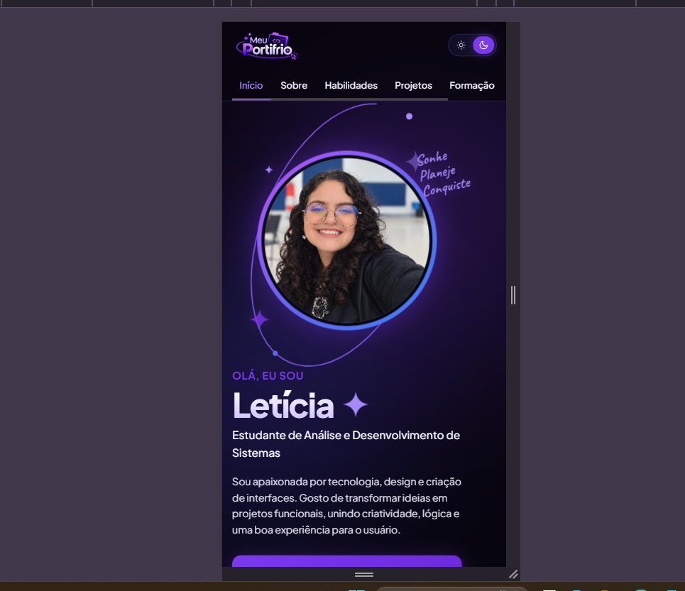

<<<<<<< HEAD
=======
# Portiforio-pessoal
# Portfólio Pessoal | Letícia

Site de portfólio de uma única página (one page), desenvolvido para a atividade de **layout com CSS Grid e Flexbox**. Apresenta Letícia, estudante de Análise e Desenvolvimento de Sistemas no Senac Minas, com suas habilidades, projetos, formação e formas de contato.

## Identificação

- **Nome completo:** _(Letícia Vieira Rivelli Miranda)_

## Links

- **Site publicado (GitHub Pages):** https://github.com/lvlv83863-oss/Portiforio-pessoal
- **Repositório:** https://github.com/lvlv83863-oss/Portiforio-pessoal.git

- **Link Carbono:** https://github.com/lvlv83863-oss/projeto-carbono-consciente.git
- **Link Fiduncia:** https://github.com/GustavoDev-07/pericia.git
- **Link Habit Tracker:** https://github.com/lvlv83863-oss/Habit-Tracker.git
- **Link Noticias2:** https://github.com/lvlv83863-oss/Noticia-2.git
- **Link Linkdin:** https://www.linkedin.com/
- **Link Instagran:** https://www.instagram.com/
- **Link Gmail:** leticiarivelli07@gmail.com

## Prints do site

| Versão desktop | Versão mobile |
|:---:|:---:|
|  |  |

## Seções do site

| Seção | `id` | O que contém |
|---|---|---|
| Cabeçalho e menu | `header` / `nav` | Logo, links âncora para todas as seções e botão de tema claro/escuro |
| Apresentação | `inicio` | Foto, nome, área de interesse, texto de apresentação e redes sociais |
| Sobre mim | `sobre` | Texto pessoal com idade, resumo da formação, cursos, foco, hobbies e uma frase de inspiração |
| Habilidades | `habilidades` | Cinco cards: Desenvolvimento Web, Programação, UI/UX, Ferramentas de TI e Aprendizado contínuo |
| Projetos | `projetos` | Cinco cards que abrem e fecham: Spotfy, Carbono consciente, Notícias, Habit Tracker e Fiducia |
| Formação e experiências | `formacao` | Análise e Desenvolvimento de Sistemas, Técnico em Informática Avançada, Excursão Tech e Curso Cisco |
| Contato | `contato` | E-mail (com botão que copia), LinkedIn, GitHub e Instagram |
| Rodapé | `footer` | Direitos autorais, ano atual, links rápidos e botão de voltar ao topo |

## Projetos apresentados

| Projeto | Descrição | Tecnologias | Link |
|---|---|---|---|
| Spotfy | Interface inspirada em um player de música | HTML, CSS, JavaScript | Em andamento |
| Carbono consciente | Plataforma educativa sobre emissões de carbono e práticas sustentáveis | HTML, CSS, JavaScript | Em andamento |
| Notícias | Portal para organizar e apresentar notícias | FrontEnd, BackEnd, SQL | [Repositório](https://github.com/lvlv83863-oss/Noticia-2.git) |
| Habit Tracker | Acompanhamento de hábitos diários, como água, leitura e sono | HTML, CSS, JavaScript | Em andamento |
| Fiducia | Site de uma empresa fictícia de perícia digital e recuperação de dados | HTML, CSS, JavaScript | [Repositório](https://github.com/GustavoDev-07/pericia.git) |

## Funcionalidades em JavaScript

- **Idade automática:** calculada a partir da data de nascimento, atualiza sozinha a cada aniversário.
- **Cards de projetos:** cada card abre e fecha para mostrar objetivo, tecnologias e link, com animação suave.
- **Tema claro e escuro:** o visitante escolhe pelo botão do cabeçalho e a escolha fica salva no navegador.
- **Copiar e-mail:** ao clicar no ícone de e-mail (no início ou no contato), o endereço é copiado e aparece a mensagem "E-mail copiado!".
- **Menu ativo:** o item do menu da seção que está na tela fica destacado ao rolar a página.
- **Ano do rodapé:** atualizado automaticamente.
- **Voltar ao topo:** botão no rodapé com rolagem suave.

## Onde usei CSS Grid

| Local | Classe | Técnica |
|---|---|---|
| Galeria de projetos | `.projetos` | `grid-template-columns: repeat(auto-fit, minmax(260px, 1fr))` e `gap: 24px` |
| Habilidades | `.habilidades` | `grid-template-columns: repeat(auto-fit, minmax(300px, 1fr))` e `gap: 18px` |
| Formação e experiências | `.formacao` | `grid-template-columns: repeat(2, 1fr)` e `gap: 18px` |
| Apresentação (desafio) | `.apresentacao` | **`grid-template-areas`**: `"texto foto"` no desktop e `"foto" "texto"` no celular |
| Sobre mim (desafio) | `.sobre` | **`grid-template-areas`**: `"texto info frase"` no desktop e uma coluna no celular |
| Abertura dos cards | `.card__detalhes` | `grid-template-rows` animando de `0fr` para `1fr` |
| Centralização | `.apresentacao__foto`, `.tema button` | `display: grid` com `place-items: center` |

## Onde usei Flexbox

| Local | Classe | Técnica |
|---|---|---|
| Barra de navegação | `.cabecalho__barra` | `justify-content: space-between`, `align-items: center`, `gap` |
| Itens do menu | `.menu__lista` | `align-items`, `justify-content: center`, `gap` |
| Interior dos cards | `.card`, `.card__corpo` | `flex-direction: column` (imagem, título, texto e botões) |
| Botões do card | `.card__acoes` | linha com `justify-content: space-between`, vira coluna no celular |
| Botões da apresentação | `.botoes`, `.redes` | `flex-wrap` e `gap` |
| Contato | `.contato`, `.contato__links`, `.contato__lista` | linha no desktop e coluna em telas menores, com `gap` |
| Rodapé | `.rodape__conteudo`, `.rodape__centro`, `.rodape__links` | `justify-content: space-between`, `align-items: center`, linha no desktop e coluna no celular |
| Etiquetas e blocos internos | `.etiquetas`, `.info`, `.habilidade`, `.formacao__item` | `flex-wrap`, `gap` e alinhamento de ícone com texto |

### Mudança de `flex-direction` conforme a tela

- **`.contato`:** linha acima de 900px, coluna até 900px.
- **`.card__acoes` e `.botoes`:** linha acima de 640px, coluna até 640px.
- **`.rodape__conteudo`:** linha acima de 640px, coluna até 640px.

## Responsividade

| Dispositivo | Largura | O que muda |
|---|---|---|
| Desktop | acima de 900px | Layout completo em colunas |
| Tablet | até 900px | Apresentação e Sobre em uma coluna, Formação em uma coluna, Contato empilhado |
| Celular | até 640px | Menu em segunda linha com rolagem horizontal, Habilidades em uma coluna, botões e rodapé empilhados |

O CSS também respeita `prefers-reduced-motion`, desativando animações para quem prefere menos movimento.

## HTML semântico e acessibilidade

- `lang="pt-BR"` na tag `<html>`.
- Uso de `<header>`, `<nav>`, `<main>`, `<section>`, `<article>`, `<aside>` e `<footer>`.
- Um único `<h1>` (o nome), seguido de `<h2>` nas seções, `<h3>` nos itens e `<h4>` nos detalhes.
- Todas as imagens têm atributo `alt`.
- Botões com `aria-label`, `aria-expanded` e `aria-controls` nos cards.
- Mensagem de e-mail copiado com `role="status"`, lida por leitores de tela.
- Ícones decorativos com `aria-hidden="true"` e foco visível nos elementos interativos.

## Organização e boas práticas

- CSS em arquivo externo, sem `<style>` e sem CSS inline no HTML.
- Variáveis em `:root` para cores, fontes, largura máxima, raio e altura do cabeçalho.
- Tema claro definido por variáveis, trocando apenas o atributo `data-theme`.
- Ícones em SVG reutilizáveis, sem dependência de bibliotecas.

## Estrutura de pastas

```
portfolio/
├── index.html
├── README.md
├── css/
│   └── style.css
├── js/
│   └── script.js
└── img/
    ├── icone.png
    ├── Selfie.png
    ├── Spotify.jpeg
    ├── carbono.jpeg
    ├── noticia.jpeg
    ├── habitos.jpeg
    ├── fiduncia.jpeg
    ├── print-desktop.png
    └── print-mobile.png
```

## Tecnologias

HTML5, CSS3 (Grid, Flexbox e variáveis), JavaScript (puro), Google Fonts (Plus Jakarta Sans e Caveat) e Git/GitHub Pages para publicação.

## Como executar

1. Baixe ou clone o repositório.
2. Abra o arquivo `index.html` no navegador. Não é preciso instalar nada.

## Publicação no GitHub Pages

1. Crie o repositório público `portfolio` na sua conta do GitHub e envie os arquivos.
2. Vá em **Settings → Pages**, escolha a branch `main` e a pasta `/ (root)` e clique em **Save**.
3. Depois de cerca de um minuto, o site fica disponível em `https://SEU-USUARIO.github.io/portfolio/`.

## Uso de Inteligência Artificial

Utilizei o **Claude (Anthropic)** como apoio para tirar dúvidas e estruturar partes do código, como o layout com Grid e Flexbox, o tema claro e escuro e a função de copiar o e-mail, alem de usar como ajuda para inspirações de layout e efeitos visuais que ajuda a melhorar a expêriencia do usuário. Revisei o código e sei explicar cada trecho caso seja solicitado.

## Autora

**Letícia Vieira**, estudante de Análise e Desenvolvimento de Sistemas no Senac Minas.
>>>>>>> b811324 (readme)
